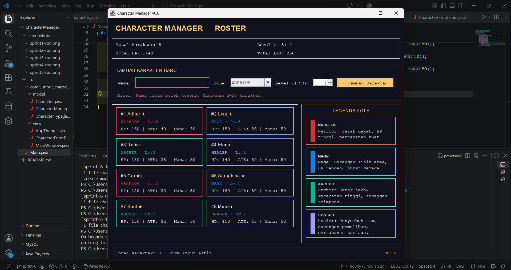
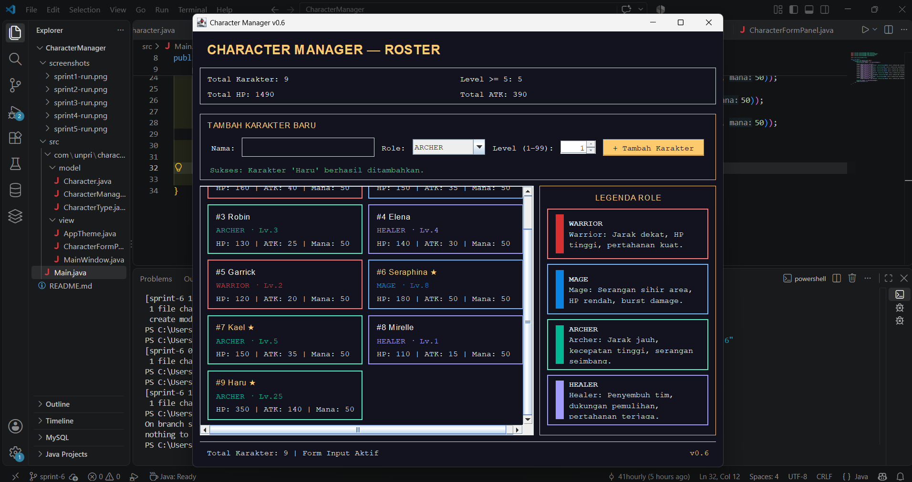

## TP14 — Form Input, Validasi & Analisis MVC (Sprint #6)

### Dokumentasi Screenshot Validasi
1. **Error Nama Kosong (Border Merah + Pesan Inline + Fokus Field):**
   
2. **Error Nama Duplikat:**
   
3. **Sukses Menambahkan Karakter Baru (Kartu Muncul Lewat `refreshList()`):**
   

### Penempatan Aturan Validasi Tambahan
1. **Aturan Format Nama (Hanya huruf, angka, dan spasi tunggal; menolak simbol & spasi ganda) — Diletakkan di `View` (`CharacterFormPanel.validateName`):**
   Aturan ini berfokus pada format input teks dari pengguna sebelum objek domain dibuat, sehingga validasi dapat berjalan berurutan (kelengkapan → panjang → format → keunikan) dan memberikan umpan balik langsung di form.
2. **Batas Maksimal 20 Karakter di Daftar Roster — Diletakkan di `Model` (`CharacterManager.addCharacter`):**
   Batas kapasitas koleksi data adalah aturan domain/invarian roster yang harus tetap terjaga meskipun karakter ditambahkan dari jalur selain form (misalnya saat pemuatan data eksternal).

### Tabel Pengujian Validasi (8 Kasus)

| No | Input (`Nama`, `Role`, `Level`) | Hasil Diharapkan | Hasil Nyata | Lapisan Penangkap |
| :- | :--- | :--- | :--- | :--- |
| 1 | `""` (kosong), `WARRIOR`, `10` | Ditolak; border nama merah, fokus kembali ke field nama, pesan kelengkapan tampil. | Sesuai harapan; pesan error kelengkapan tampil, border nama merah, dan fokus kembali ke field nama. | **View** (`CharacterFormPanel`) |
| 2 | `"   "` (spasi saja), `MAGE`, `5` | Setelah `trim()` kosong, ditolak dengan pesan kelengkapan. | Sesuai harapan; input dibersihkan dengan `trim()` lalu ditolak dengan pesan kelengkapan. | **View** (`CharacterFormPanel`) |
| 3 | `"A"`, `ARCHER`, `12` | Ditolak karena panjang nama kurang dari batas minimum (2 karakter). | Sesuai harapan; muncul pesan bahwa panjang nama harus 2–20 karakter. | **View** (`CharacterFormPanel`) |
| 4 | `"Zed@99"`, `WARRIOR`, `15` | Ditolak karena mengandung karakter simbol `@` yang tidak sesuai format. | Sesuai harapan; ditolak oleh aturan format di `validateName` dengan pesan spesifik. | **View** (`CharacterFormPanel`) |
| 5 | `"Arthur"`, `WARRIOR`, `20` | Ditolak karena nama sudah terdaftar di roster. | Sesuai harapan; `isNameTaken()` mendeteksi duplikasi dan menampilkan pesan error. | **View** (`CharacterFormPanel`) |
| 6 | `"Merlin"`, `MAGE`, `65` | Ditolak karena `MAGE` tidak boleh memiliki level di atas 60 (Mini-Challenge). | Sesuai harapan; `Character` melempar `IllegalArgumentException` dan form menampilkan pesan dari `ex.getMessage()`. | **Model** (`Character`) |
| 7 | `"Valkyrie"`, `HEALER`, `105` | Ditolak karena level berada di luar rentang `1–99`. | Sesuai harapan; nilai di luar rentang `1–99` ditolak dan pesan error ditampilkan. | **View / Model** (`JSpinner` & `Character`) |
| 8 | `"  Orion  "`, `ARCHER`, `25` | Nama di-`trim()` menjadi `"Orion"`, kartu baru langsung tampil via `refreshList()`. | Sesuai harapan; kartu karakter baru muncul di daftar dan statistik/status bar ikut diperbarui. | **Lolos Validasi (Sukses)** |

#### Catatan Perbedaan & Tindakan Perbaikan
* Tidak ada ketidaksesuaian antara hasil nyata dan hasil diharapkan setelah memastikan `spinner.commitEdit()` dipanggil sebelum membaca nilai `JSpinner` dan `refreshList()` memanggil `revalidate()` serta `repaint()`.

### Kompromi Sementara (Sprint #6)
Pada implementasi Sprint #6 ini, penanganan submit form masih menggunakan `ActionListener` minimal di dalam `CharacterFormPanel` yang langsung memanggil `manager.addCharacter(newChar)` pada lapisan *View*. Hal ini dipilih sebagai kompromi sementara agar alur validasi dua lapis dan pembaruan daftar (`refreshList()`) dapat diuji secara langsung tanpa menambah kelas perantara sebelum materi *Controller* dan *Observer* diterapkan. Pada Pertemuan 9, pemanggilan langsung ke `CharacterManager` dari *View* akan dipindahkan ke kelas *Controller* khusus sehingga pemisahan tanggung jawab MVC menjadi semakin rapi.

### Link Analisis Bagian D (Google Docs)
* [Analisis Input & Validasi MVC — TP14 (Google Docs)](https://docs.google.com/document/d/1i3PItcTh8meCkmxqnIrHgi42e921HnH0aq2_eSJBA-Y/edit?usp=sharing)